  

###

  

###

<h1 data-importer="text" align="center">Nicolas Freitas</h1>

###

<h3 data-importer="text" align="left">About Me</h3>

###

I'm Nicolas Freitas, a student with an interdisciplinary background combining technology and the social sciences. I am an undergraduate student in Social Sciences at the Federal University of Uberlândia (UFU), with an interdisciplinary background in Information Systems and a strong interest in the intersection of technology, society, and data.

###

<h3 data-importer="text" align="left">Core Interests</h3>

###

  • 🤖 Machine Learning and Artificial Intelligence 
  • 🔍 Anthropology and Social Research 
  • 📊 Data Analysis and Computational Methods 
  • 🌐 The relationship between technology, digital culture, and society
    
  I am particularly focused on exploring how computational tools and quantitative methods can deepen our understanding of human behavior, institutional dynamics, and collective social phenomena.

###

<h3 data-importer="text" align="left">Technologies & Tools</h3>

###

  
  
  
  
  

###

### Languages

<table align="center">
  <tr>
    <th>Language</th>
    <th>Proficiency</th>
  </tr>
  <tr>
    <td>🇧🇷 Portuguese</td>
    <td>Native</td>
  </tr>
  <tr>
    <td>🇺🇸 English</td>
    <td>Intermediate</td>
  </tr>
  <tr>
    <td>🇩🇪 German</td>
    <td>Basic</td>
  </tr>
</table>

<h3 data-importer="text" align="left">My Stats</h3>

###

  
  

###
